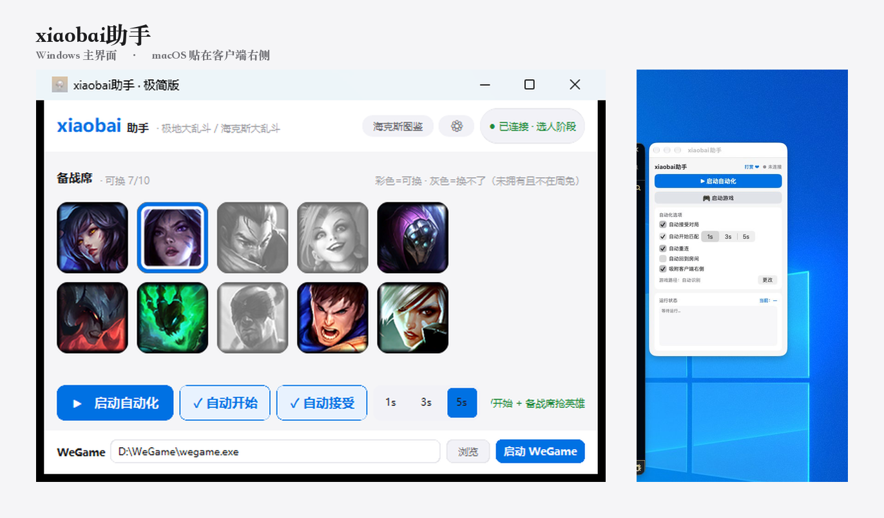
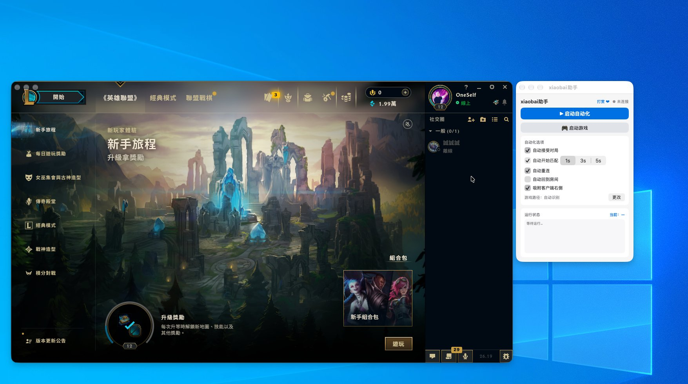

# xiaobai助手

英雄联盟极地大乱斗 / 海克斯大乱斗的本地助手。Windows 和 macOS 的源码都在这个仓库。

官网：<https://xiaobainsj.ccwu.cc/xiaobai-helper/>



两边都做这些事：自动接受对局、自动开始匹配、掉线重连、结算后回到房间、领取奖励、备战席抢英雄。只调用本机官方 LCU 接口，不注入进程、不读写内存、不模拟键鼠、不做 OCR。

Windows 这张图是较早的窗口。顶栏上的「海克斯图鉴」已经从当前源码去掉，备战席和下面的按钮还是现在的布局。

## 两个版本

| | Windows | macOS |
|---|---|---|
| 源码 | 仓库根目录，Python | [`macos/`](macos/) ，Swift |
| 安装包 | [本仓库 Releases](https://github.com/lixyd/lol-helper/releases/latest) 的 `xiaobai-helper-windows.zip`，解压后管理员运行 `ARAMHelper.exe` | [lol-mac-helper Releases](https://github.com/lixyd/lol-mac-helper/releases/latest) 的 zip。最新安装包是 v0.6.0 |
| 只这一边有的 | 对局中自动隐藏并吸附客户端右上角、托盘、开机自启、WeGame 一键启动 | 一键启动游戏、窗口贴在客户端右侧。不需要辅助功能权限 |

macOS 源码里还有自动领取奖励，以及对局开始隐藏、结束弹出。这两项还没打进 v0.6.0 安装包，要用的话在 `macos/` 里自己构建。

## 从源码运行

Windows，Python 3.9–3.13：

```bat
git clone https://github.com/lixyd/lol-helper.git
cd lol-helper
python -m venv .venv & .venv\Scripts\activate & pip install -r requirements.txt
python ctk_launcher.py
```

本机打包：`python build.py`，产物在 `dist\build_*\ARAMHelper\`。不要在 Linux 上交叉打 exe。

macOS 13+，需要 Xcode Command Line Tools：

```zsh
git clone https://github.com/lixyd/lol-helper.git
cd lol-helper/macos
./build.sh
```

脚本会编出 `macos/build/xiaobai助手.app`，并复制一份到桌面。

## 备战席

头像墙只在选人阶段、备战席真正打开时出现。判据是 `/lol-champ-select/v1/session` 的 `benchEnabled`。彩色可以换，灰色是未拥有且不在周免。点一个头像作为目标，客户端一放行就换上。

换人接口是 `POST /lol-champ-select/v1/session/bench/swap/{championId}`。

## 领取奖励

Windows 源码，以及 macOS 源码（未进 v0.6.0 安装包），都会扫这三处：

| 来源 | 查询 | 领取 |
|---|---|---|
| 宝箱、胶囊、图标 | `GET /lol-rewards/v1/grants?status=PENDING_SELECTION` | `POST /lol-rewards/v1/grants/{id}/select` |
| 任务 | `GET /lol-missions/v1/missions` 里状态为 `SELECT_REWARDS` 的 | `PUT /lol-missions/v1/player/{id}` |
| 事件中心 / 通行证 | `GET /lol-event-hub/v1/events` 里 `unclaimedRewardCount > 0` 的 | `POST /lol-event-hub/v1/events/{id}/reward-track/claim-all` |

## 界面




## 声明

本工具与 Riot Games、腾讯无关，只供学习交流。请遵守游戏用户协议。

MIT
